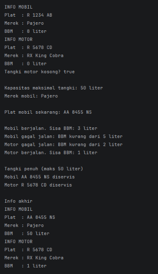

# Sistem Kendaraan Otomotif

## 1. Identitas

- **Nama:** Pandu Hendra Baskara
- **NIM:** H1D025139
- **Tema:** Otomotif

## 2. Deskripsi Sistem

Simulasi sistem kendaraan sederhana. 
**Mobil** memakai 5 liter BBM setiap berjalan dan bisa diisi BBM serta diservis.
**Motor** memakai 2 liter BBM setiap berjalan dan bisa diservis. Keduanya berbagi struktur dasar lewat superclass abstract `Kendaraan`.

## 3. Struktur Project

```
otomotif-app/
├── README.md
└── src/
    ├── Kendaraan.java    # abstract superclass
    ├── Servisable.java   # interface
    ├── BisaIsiBBM.java   # interface
    ├── Mobil.java        # subclass
    ├── Motor.java        # subclass
    └── Main.java         # class penguji (terpisah)
```

## 4. Pemetaan Persyaratan Teknis

| No | Requirement | Lokasi di Kode |
|----|-------------|----------------|
| 1 | State & Behavior | `Kendaraan`: atribut `merek`, `platNomor`, `bahanBakar`; `tampilkanInfo()` (void); `isTangkiKosong()` (return value) |
| 2 | Immutability | `BBM_MAKSIMAL` (`public static final`) dan `merek` (`private final`) di `Kendaraan` |
| 3 | Enkapsulasi & Overloading | Semua atribut `private` + getter/setter, memakai `this`, 2 konstruktor di `Kendaraan` |
| 4 | Inheritance | `Mobil extends Kendaraan`, `Motor extends Kendaraan`; `Main` terpisah |
| 5 | Super Chaining | `super(...)` di konstruktor `Mobil` dan `Motor`; `super.tampilkanInfo()` di override |
| 6 | Method Overriding | `@Override` pada `tampilkanInfo()`, `berkendara()`, `servis()`, dan `isiBahanBakar()` |
| 7 | Abstract Class | `Kendaraan` bersifat `abstract` dengan `abstract void berkendara()` |
| 8 | Logika State Percabangan | `if/else` pada `berkendara()` di `Mobil` dan `Motor` yang membaca dan mengubah BBM |
| 9 | Polimorfisme Interface | `BisaIsiBBM pengisi = mobil;` dan `Servisable s1 = mobil;` di `Main.java` |
| 10 | Multiple Interface | `Mobil implements Servisable, BisaIsiBBM` |

## 5. Cara Compile & Run (Terminal)

```bash
cd src
javac *.java
java Main
```

## 6. Screenshot Output Program
